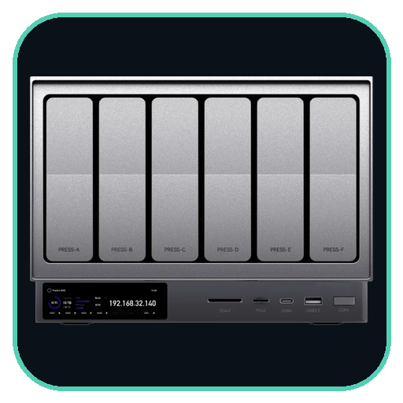
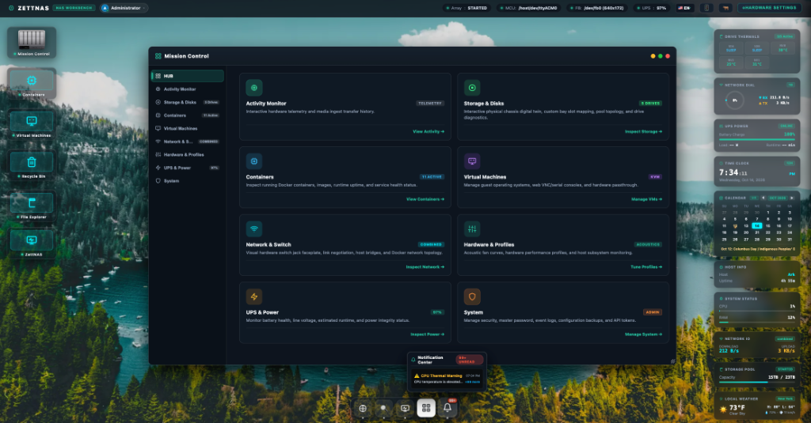

<div align="center">
  
  <h1>ZettNAS Toolkit</h1>
  <p><strong>Find any file by what is in it, and ask about your files, privately on your own NAS. Plus files, apps, storage, backups and hardware in one web desktop.</strong></p>
  <p>
    <a href="https://github.com/fr0styx/zettnas-toolkit/releases"></a>
    <a href="LICENSE"></a>
    
  </p>
  
</div>

**Private search, on your hardware.** Ask Zetty searches your documents, photos and scans by
what is in them, in five languages, and answers with the files it used. The search runs on the
NAS, your files and their index stay there, and web search is off until you turn it on. No
account, no subscription. How well it finds things is measured on a public test set:
[Search quality](docs/SEARCH_QUALITY.md). What it may and may not do: [Safe AI](docs/SAFE_AI.md).

ZettNAS runs as one container next to your existing system: Unraid, Debian, Ubuntu, TrueNAS SCALE, Proxmox, FygoOS or plain Docker. It works on any NAS or homelab server, and adds extras on appliances with a front LCD, a light bar or a card reader (Zettlab, Aoostar).

## What you get

- **Ask Zetty** — search and questions over your own files in five languages, on the NAS's own GPU or NPU; answers are checked against your files and cite them. Also available to Claude, Cursor and other AI clients over MCP.
- **Files** — a File Explorer with several windows, drag and drop, a Recycle Bin, share links, a photo and video viewer, and import from the front card reader with checksum verification.
- **Apps** — 78 tested one-click apps (Immich, Jellyfin and more), Docker Compose stacks, logs, a web terminal and update checks.
- **Storage** — pools, disks and SMART health on ZFS, Btrfs, mdadm and Unraid arrays; disks that are likely to fail turn amber before SMART calls them failed; sleeping disks stay asleep.
- **Snapshots and backup** — per-share snapshot schedules with file restore and Windows "Previous Versions", encrypted offsite backup with restic, and scheduled backups of ZettNAS's own settings.
- **People** — accounts with roles, private folders and space quotas, invite links, guest and kid roles with sign-in hours, two-factor sign-in, and sign-in with OpenID Connect or LDAP.
- **Virtual machines** — KVM with UEFI and TPM 2.0, an ISO catalog, and a console in the browser.
- **Hardware** — fan curves, UPS monitoring with safe shutdown, the front LCD and light bar, and alerts by e-mail, Telegram, Discord, ntfy and more.
- **Safety** — a ransomware guard that freezes writes and snapshots the pool, an allow-list in front of Docker, and updates that check the image signature and roll back on their own.
- **Everywhere** — a phone mode you can install as an app, light and dark themes, and English, German, French, Spanish and Chinese.

## Quick start

```bash
mkdir -p zettnas && cd zettnas
curl -fsSLO https://raw.githubusercontent.com/fr0styx/zettnas-toolkit/main/docker-compose.linux.yml
docker compose -f docker-compose.linux.yml up -d
```

Open `http://<server-ip>:8082` and sign in as `admin`. There is no default password: ZettNAS creates a first-time password, prints it in the container log (`docker logs zettnas-toolkit`) and saves it as `initial-admin-password` in the data folder, unless you set `WEB_PASSWORD`. You pick your own at first sign-in.

On Unraid, use the template in [`unraid/zettnas-toolkit.xml`](unraid/zettnas-toolkit.xml). Every platform, the device mappings and all settings are in the **[installation guide](docs/INSTALLATION.md)**.

## Images and updates

| Image tag | What it is |
|---|---|
| `latest` | Stable: a weekly train every Tuesday, with the newest release that has had 3 days on beta. The default. |
| `beta` | A new release as soon as its tests pass. |
| `edge` | Every commit on `main` that passes CI. |
| `…-core` | Any of the above without virtual machines or Chromium, about 500 MB instead of 1.7 GB. |

Images are signed in CI; ZettNAS verifies the signature before it installs an update, and keeps the previous version until the new one is healthy. Choose the channel with `UPDATE_CHANNEL` (`stable`, `beta`, `edge`) or in Mission Control → Settings → About & Updates. See [releasing](docs/RELEASING.md).

## Documentation

| Topic | Guide |
|---|---|
| Install on Unraid, Linux, TrueNAS, FygoOS or Docker | [INSTALLATION.md](docs/INSTALLATION.md) |
| Every setting | [CONFIGURATION.md](docs/CONFIGURATION.md) |
| HTTPS with Nginx, Caddy, Traefik | [REVERSE_PROXY.md](docs/REVERSE_PROXY.md) |
| Sign-in with OpenID Connect or LDAP | [SSO.md](docs/SSO.md) |
| Backing up your computers; disaster recovery | [BACKUP_GUIDE.md](docs/BACKUP_GUIDE.md) |
| Using ZettNAS and Immich away from home (Tailscale, Headscale) | [REMOTE_ACCESS.md](docs/REMOTE_ACCESS.md) |
| Ask Zetty and document search | [RAG.md](docs/RAG.md) |
| How well search works, measured | [SEARCH_QUALITY.md](docs/SEARCH_QUALITY.md) |
| What the AI may and may not do | [SAFE_AI.md](docs/SAFE_AI.md) |
| AI clients over MCP | [MCP.md](docs/MCP.md) |
| What leaves the NAS, and when | [PRIVACY.md](docs/PRIVACY.md) |
| Security policy and threat model | [SECURITY.md](SECURITY.md), [THREAT_MODEL.md](docs/THREAT_MODEL.md) |
| REST API (`/api/v1`) | [API.md](docs/API.md) |
| How it is built | [ARCHITECTURE.md](docs/ARCHITECTURE.md), [HARDWARE_PROTOCOL.md](docs/HARDWARE_PROTOCOL.md) |
| What changed | [CHANGELOG.md](CHANGELOG.md) |

## Development

The backend is FastAPI with SQLite; the frontend is plain JavaScript modules built with Vite.

```bash
npm install && npm run build      # frontend into static/
npm test                          # frontend tests (Vitest)
docker compose -f docker-compose.dev.yml --profile test run --rm zettnas-test   # backend tests (pytest)
```

Read [CONTRIBUTING.md](CONTRIBUTING.md) before opening a pull request, and [AGENTS.md](AGENTS.md) for the project's rules and invariants.

## Credits

- [torharrington/zettlab-display](https://github.com/torharrington/zettlab-display) — early framebuffer layouts for the Zettlab front screen.
- [henryxwong/zettlab-ubuntu](https://github.com/henryxwong/zettlab-ubuntu) — reverse engineering of the Zettlab fan, LED and register interfaces.
- [GeoNames](https://www.geonames.org/) — the town names photos are given from their GPS position, offline ([CC BY 4.0](https://creativecommons.org/licenses/by/4.0/); see backend/geodata).

## License

[MIT](LICENSE)
