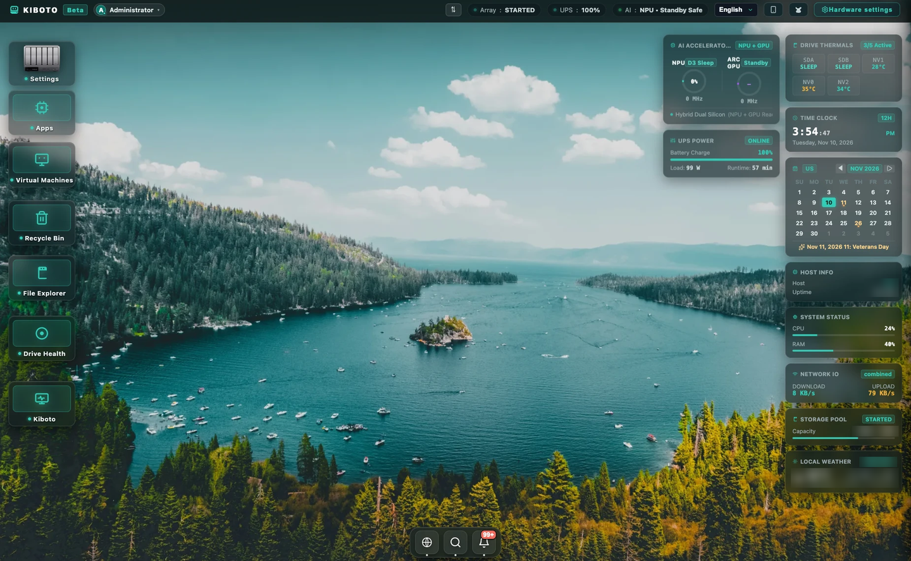

<div align="center">
  <picture>
    <source media="(prefers-color-scheme: dark)" srcset="docs/img/kiboto-lockup-on-dark.svg">
    
  </picture>
  <p><strong>The operating system for your home NAS.</strong> Storage, apps, virtual machines, backups, remote access and hardware, run from one web desktop, with Kib, a private assistant that knows what's in your files.</p>
  <p>
    <a href="https://github.com/fr0styx/kiboto/releases"></a>
    <a href="LICENSE"></a>
    
    
  </p>
  <p><a href="https://kiboto.net">kiboto.net</a></p>
  
</div>

Kiboto is an operating system for a home NAS. Today it runs as one container on the system you already
have (Unraid, Debian, Ubuntu, TrueNAS SCALE, Proxmox, FygoOS or plain Docker); full Kiboto OS images
for NAS boxes are on the way. It works on any NAS or homelab server, and drives the front screen, the
fans and the light bar on Zettlab and Aoostar boxes.


**Meet Kib.** Ask Kib finds your documents, photos and scans by what is in them, privately and in
five languages, and answers with the files it used. Kib runs on the NAS: your files and their index stay there, and
web search is off until you turn it on. No account, no subscription. How well it finds things is
measured on a public test set ([search quality](docs/SEARCH_QUALITY.md)); what it may and may not do
is written down and tested ([safe AI](docs/SAFE_AI.md)).

## What you get

- **Ask Kib**: search and questions over your own files in five languages, on the NAS's own GPU or
  NPU; answers are checked against your files and cite them. Claude, Cursor and other AI clients can
  use it over MCP.
- **Files**: a File Explorer with several windows, drag and drop, a Recycle Bin, share links and
  "send me files" links, a photo and video viewer, and verified import from the front card reader.
- **Apps**: 78 tested one-click apps (Immich, Jellyfin, Nextcloud and more), Docker Compose stacks,
  Unraid, CasaOS and Umbrel templates marked "community, untested", logs, a web terminal and update checks.
- **Storage**: pools, disks and SMART health on ZFS, Btrfs, mdadm and Unraid arrays; disks likely to
  fail turn amber before SMART calls them failed; sleeping disks stay asleep.
- **Snapshots and backup**: snapshot schedules with file restore and Windows "Previous Versions",
  encrypted off-site backup with restic, a recovery kit that restores a whole box, and backups to a
  second Kiboto box (append-only, so ransomware can't wipe them).
- **Family**: accounts with roles, private folders and quotas, invite links, kid accounts with
  sign-in hours and a device filter, passkeys and two-step sign-in, and one passkey sign-in for the
  family's apps through Pocket ID.
- **From anywhere**: Tailscale set up from a QR code, HTTPS for Kiboto and every app in your tailnet,
  a guided invite for each family member, and share links or chosen apps on the internet without
  opening a port. Kiboto's own pages never go on the internet.
- **Virtual machines**: KVM with UEFI and TPM 2.0, an ISO catalog and a console in the browser.
- **Hardware**: fan curves, UPS monitoring with safe shutdown, the front LCD and light bar, and alerts
  by e-mail, Telegram, Discord, ntfy and more. Raw hardware access can live in a small helper
  container instead of Kiboto itself.
- **Safety**: a ransomware guard that freezes writes and snapshots the pool, an allow-list in front of
  Docker, and updates that check the image signature and roll back on their own.
- **Everywhere**: an installable phone app (PWA), light and dark themes, and English, German, French,
  Spanish and Chinese.

## Quick start

```bash
mkdir -p kiboto && cd kiboto
curl -fsSLO https://raw.githubusercontent.com/fr0styx/kiboto/main/docker-compose.linux.yml
docker compose -f docker-compose.linux.yml up -d
```

Open `http://<server-ip>:8082` and sign in as `admin`. There is no default password: Kiboto creates a
first-time password, prints it in the container log (`docker logs kiboto`) and saves it as
`initial-admin-password` in the data folder, unless you set `WEB_PASSWORD`. You pick your own at
first sign-in.

On Unraid, use the template in [`unraid/kiboto.xml`](unraid/kiboto.xml). Every platform, the device
mappings and all settings are in the **[installation guide](docs/INSTALLATION.md)**. An install from
before the rename updates in place and keeps its settings.

## Images and updates

The image is `ghcr.io/fr0styx/kiboto`. Until 2.0.0 turns stable on 17 November its `latest` tag is
published under the old name, `ghcr.io/fr0styx/zettnas-toolkit`, which the compose files and the
Unraid template still use; both names carry the same signed images until Kiboto 2.2.

| Image tag | What it is |
|---|---|
| `latest` | Stable: a weekly train every Tuesday, with the newest release that has had 3 days on beta. The default. |
| `beta` | A new release as soon as its tests pass. |
| `edge` | Every commit on `main` that passes CI. |
| `…-core` | Any of the above without virtual machines or Chromium, about 500 MB instead of 1.7 GB. |

Images are signed in CI; Kiboto verifies the signature before it installs an update, and keeps the
previous version until the new one is healthy. Choose the channel with `UPDATE_CHANNEL` (`stable`,
`beta`, `edge`) or in Mission Control → Settings → About & Updates. A release bundles a few days of
work and goes up one patch number at a time: see [releasing](docs/RELEASING.md).

## Documentation

| Topic | Guide |
|---|---|
| Install on Unraid, Linux, TrueNAS, FygoOS or Docker | [INSTALLATION.md](docs/INSTALLATION.md) |
| Every setting | [CONFIGURATION.md](docs/CONFIGURATION.md) |
| HTTPS with Nginx, Caddy, Traefik | [REVERSE_PROXY.md](docs/REVERSE_PROXY.md) |
| Using Kiboto away from home; the family's own way in | [REMOTE_ACCESS.md](docs/REMOTE_ACCESS.md) |
| Passkeys; one sign-in for the family's apps | [PASSKEYS.md](docs/PASSKEYS.md), [FAMILY_SIGNIN.md](docs/FAMILY_SIGNIN.md) |
| Sign-in with OpenID Connect or LDAP | [SSO.md](docs/SSO.md) |
| Backing up your computers, a second box, disaster recovery | [BACKUP_GUIDE.md](docs/BACKUP_GUIDE.md) |
| Ask Kib and document search | [RAG.md](docs/RAG.md) |
| How well search works, measured | [SEARCH_QUALITY.md](docs/SEARCH_QUALITY.md) |
| What the AI may and may not do | [SAFE_AI.md](docs/SAFE_AI.md) |
| AI clients over MCP | [MCP.md](docs/MCP.md) |
| What leaves the NAS, and when | [PRIVACY.md](docs/PRIVACY.md) |
| Security policy and threat model | [SECURITY.md](SECURITY.md), [THREAT_MODEL.md](docs/THREAT_MODEL.md) |
| REST API (`/api/v1`) | [API.md](docs/API.md) |
| How it is built | [ARCHITECTURE.md](docs/ARCHITECTURE.md), [HARDWARE_PROTOCOL.md](docs/HARDWARE_PROTOCOL.md) |
| Logo, colours and Kib | [BRAND.md](docs/BRAND.md) |
| What changed | [CHANGELOG.md](CHANGELOG.md) |

## Development

The backend is FastAPI with SQLite; the frontend is plain JavaScript modules built with Vite.

```bash
npm install && npm run build      # frontend into static/
npm test                          # frontend tests (Vitest)
docker compose -f docker-compose.dev.yml --profile test run --rm kiboto-test   # backend tests (pytest)
```

Read [CONTRIBUTING.md](CONTRIBUTING.md) before opening a pull request, and [AGENTS.md](AGENTS.md) for
the project's rules and invariants.

## Credits

- [torharrington/zettlab-display](https://github.com/torharrington/zettlab-display): early framebuffer layouts for the Zettlab front screen.
- [henryxwong/zettlab-ubuntu](https://github.com/henryxwong/zettlab-ubuntu): reverse engineering of the Zettlab fan, LED and register interfaces.
- [GeoNames](https://www.geonames.org/): the town names photos are given from their GPS position, offline ([CC BY 4.0](https://creativecommons.org/licenses/by/4.0/); see backend/geodata).
- [Pocket ID](https://pocket-id.org): the passkey sign-in provider behind family sign-in.

## License

[MIT](LICENSE)
