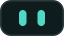
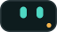
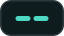

# Kiboto's logo, colours and Kib

How Kiboto looks, for anyone writing about it, packaging it or building on it. The files are in
[`docs/img`](img); the app's own icons are in `frontend/public/img`.

## The mark

The front of a small NAS: a display with two lit eyes over a drive tray with one amber status light.
It sits next to a lowercase `kiboto` wordmark whose i-dot is the same amber light.

| File | Use |
|---|---|
| [`kiboto-lockup.svg`](img/kiboto-lockup.svg), [`kiboto-lockup-on-dark.svg`](img/kiboto-lockup-on-dark.svg) | Mark and wordmark together, on light and dark backgrounds |
| [`kiboto-mark.svg`](img/kiboto-mark.svg), [`kiboto-mark-mono.svg`](img/kiboto-mark-mono.svg) | The mark alone, in colour or one colour (`currentColor`) |
| `frontend/public/img/favicon.svg`, `icon-192.png`, `icon.png`, `icon-512.png` (maskable), `apple-touch-icon.png` | Browser tab, installed app and home screen |

Leave space around the mark of at least the height of its drive tray, and don't recolour, stretch or
outline it. On a busy background, use the one-colour mark.

## Colours: Lagoon

Teal does the work, amber marks what is alive or needs a look, and the neutrals lean blue-green. Every
text and control pair passes WCAG AA in both themes.

| Role | Dark theme (the default) | Light theme |
|---|---|---|
| Primary | `#33cdb8` | `#0a7a70` |
| Accent (status light) | `#f6b44c` | `#f2a93b` |
| Background | `#0a1113` | `#f3f6f6` |
| Surface | `#121b1e` | `#ffffff` |
| Text | `#e6efef` | `#0e1c1e` |
| Muted text | `#95a8ab` | `#4a5c60` |
| Success / warning / danger / info | `#46c776` / `#f2b237` / `#f26b5e` / `#6f9cf5` | `#1d7a3e` / text colours darker |

The full set of tokens (with hover, "on" and soft variants, radii, spacing, motion) is
[`docs/img/kiboto-tokens.css`](img/kiboto-tokens.css).

## Kib

   

Kib is Kiboto's assistant, and its face is the display on the mark: a dark tile with lit eyes. It has
four expressions: idle, thinking, found it and unsure (when the answer isn't in your files). Kib is
not a chat bubble or a robot head.

## Type

M PLUS Rounded 1c for display text, Atkinson Hyperlegible Next for the interface, Atkinson Hyperlegible
Mono for numbers and data.

## The front screen

A boot screen in the brand for the 640×172 front LCD is in [`lcd-boot-640x172.svg`](img/lcd-boot-640x172.svg).
The front screen's texts stay in English.
